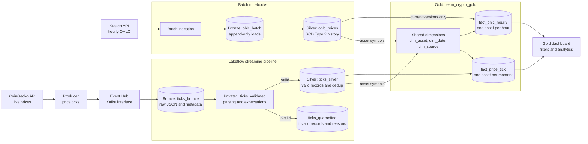
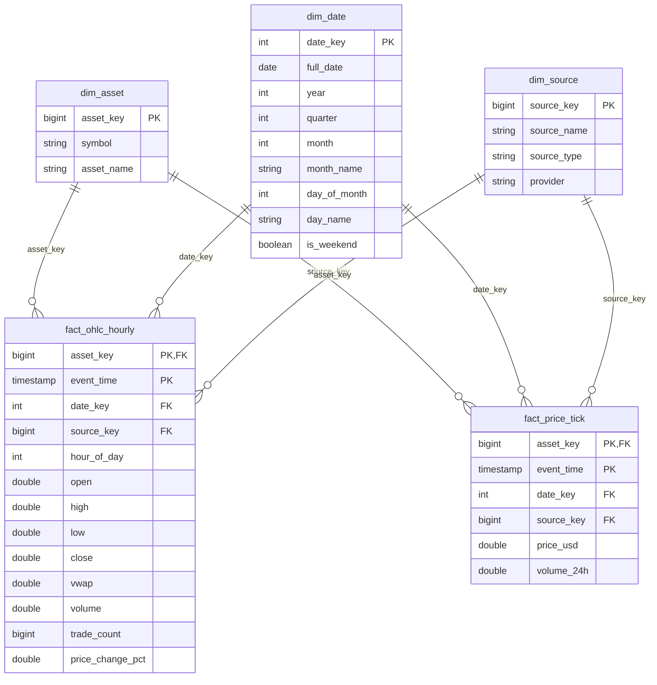

# crypto-demo

A cryptocurrency medallion lakehouse combining batch OHLC data and streaming price ticks, with data-quality controls, SCD Type 2 history, and governed Gold analytics.
## Architecture



Batch and streaming run independently and each writes its own silver table (`ohlc_prices`, `ticks_prices`). 

## Repo structure

| Folder / file | What it does |
|---|---|
| `batch_pipeline/01_batch_ohlc_ingestion.ipynb` | Loads hourly OHLC data from Kraken API (BTC, ETH, SOL) into `team_crypto_bronze.ohlc_batch`тusing append-only writes; adds a stable `entry_id` and ingestion timestamp |
| `batch_pipeline/02_silver_ohlc.ipynb` | Processes the latest Bronze load, normalizes and deduplicates records, and maintains SCD Type 2 history in `team_crypto_silver.ohlc_prices` |
| `streaming_pipeline/01_producer_price_ticks.ipynb` | Polls CoinGecko `simple/price` every N seconds, sends JSON to Event Hub over the Kafka protocol. `bad_every` widget injects bad events for the data-quality demo, `include_volume` adds `volume_24h` (schema evolution twist) |
| `lakeflow_pipeline/transformations/ticks_bronze.py` | Lakeflow streaming table: Event Hub (Kafka) → `team_crypto_bronze.ticks_bronze`, raw JSON plus Event Hub metadata |
| `lakeflow_pipeline/transformations/ticks_silver.py` | Lakeflow: bronze → private `_ticks_validated` → `team_crypto_silver.ticks_silver` (valid, deduplicated ticks) |
| `lakeflow_pipeline/transformations/ticks_quarantine.py` | Lakeflow: invalid ticks with original JSON and rejection reasons → `team_crypto_silver.ticks_quarantine` |
| `lakeflow_pipeline/utilities/ticks_transformations.py` | Plain PySpark functions used by the pipeline (`parse_and_validate_ticks`, `normalize_symbol`, `RULES`); importable from unit tests |
| `lakeflow_pipeline/checks/streaming_quality_checks.ipynb` | Manual checks across bronze / silver / quarantine; catalog and schemas are widgets |
| `streaming_pipeline/02_consumer_bronze_ticks.ipynb` | Structured Streaming from Event Hub (Kafka format) into `team_crypto_bronze.ticks_stream`, stored as raw JSON (no fixed schema — needed for the schema evolution demo) |
| `streaming_pipeline/03_schema_evolution_twist.ipynb` | Demo helper: checks that a new field reaches silver without restarting the stream |
| `streaming_pipeline/04_silver_prices.ipynb` | Infers schema from the newest bronze row (`F.schema_of_json`), normalizes symbol (bitcoin → BTC etc.), MERGE into `team_crypto_silver.ticks_prices` |
| `integration_pipeline/01_unified_silver_prices.ipynb` | Combines `ohlc_prices` + `ticks_prices` into one table with a `record_type` column (`ohlc_batch` / `streaming_tick`), MERGE into `team_crypto_silver.unified_prices` |
| `gold_pipeline/00_gold_setup.ipynb` | DDL of gold tables (PK/FK, comments, clustered by `date_key`); run once |
| `gold_pipeline/01_gold_dim_date.ipynb` | Calendar `dim_date`, 2025-01-01 … 2030-12-31; run once |
| `gold_pipeline/02_gold_dims.ipynb` | `dim_source` (static) and `dim_asset` (symbols from silver), insert-only MERGE |
| `gold_pipeline/03_gold_fact_ohlc_hourly.ipynb` | `fact_ohlc_hourly` from current SCD2 versions of `ohlc_prices`, with quality gate |
| `gold_pipeline/04_gold_fact_price_tick.ipynb` | `fact_price_tick` from `ticks_silver`, with quality gate |
| `gold_pipeline/05_governance.ipynb` | `access_rules`, row filter, column mask, grants; demo cells for RLS/CLS |
| `gold_pipeline/utilities/gold_transformations.py` | Plain PySpark functions used by gold notebooks; importable from unit tests |
| `dashboard_queries/gold_dashboard_queries.sql` | SQL datasets of the gold dashboard (latest prices, hourly candles, daily summary, live ticks) |  
| `infra_setup.ipynb` | Schemas, volume, secret scope (Unity Catalog setup) |
| `README.md` | This file |

## Run order

1. `infra_setup.ipynb` — once, by whoever owns infra
2. `batch_pipeline/01_batch_ohlc_ingestion.ipynb` → `batch_pipeline/02_silver_ohlc.ipynb`
3. Run `streaming_pipeline/01_producer_price_ticks.ipynb` to send events, then run the Lakeflow pipeline `team-crypto-ticks-streaming` to update streaming Bronze, Silver and Quarantine.
4. Optionally run `lakeflow_pipeline/checks/streaming_quality_checks.ipynb` against the configured schemas.
5. Initialize Gold once:
   - `gold_pipeline/00_gold_setup.ipynb`
   - `gold_pipeline/01_gold_dim_date.ipynb`
6. After both Silver paths are ready, run:
   - `gold_pipeline/02_gold_dims.ipynb`
   - `gold_pipeline/03_gold_fact_ohlc_hourly.ipynb`
   - `gold_pipeline/04_gold_fact_price_tick.ipynb`
7. Run `gold_pipeline/05_governance.ipynb` for the initial RLS/CLS setup. Execute its demonstration cells separately when demonstrating access restrictions.
8. Refresh the "Crypto Prices - Gold" dashboard.

## Schema evolution demo

1. Start the producer and consumer, let them run for a few minutes
2. In `01_producer_price_ticks.ipynb`, uncomment the line that adds a new field, `volume_24h`
3. Restart only the producer — the consumer (`02_consumer_bronze_ticks`) doesn't need touching, since it just stores raw JSON
4. Rerun `04_silver_prices.ipynb` — the new field shows up automatically via `F.schema_of_json()` on the latest row, no code change and no stream restart needed

## Lakeflow streaming pipeline

The streaming part is moving from notebooks 02/04 to a Lakeflow Declarative Pipeline, `team-crypto-ticks-streaming`. Every `.py` file in `lakeflow_pipeline/transformations/` is picked up by the pipeline.

| Table | Layer | Contents |
|---|---|---|
| `<bronze_schema>.ticks_bronze` | bronze | `value` (raw JSON string), `eventhub_partition`, `eventhub_offset`, `eventhub_timestamp`, `source`, `ingestion_timestamp`, `load_date` |
| `_ticks_validated` | intermediate (private) | All Bronze records with parsed fields, normalized `symbol`, numeric `price_usd`, converted `event_time`, individual quality-rule results, `failed_rules`, `is_valid`, and `quarantine_reason` |
| `<silver_schema>.ticks_silver` | silver | Valid records deduplicated by `symbol, event_time, source` within a 10-minute watermark: `symbol`, `event_time`, `price_usd`, `volume_24h`, `quote_currency`, `source`, `transport_source`, `ingestion_timestamp`, `load_date`, `eventhub_partition`, `eventhub_offset`, `eventhub_timestamp` |
| `<silver_schema>.ticks_quarantine` | quarantine | Invalid records: original `value`, `raw_symbol`, `symbol`, `price_usd`, `event_time`, `failed_rules`, `quarantine_reason`, `source`, `ingestion_timestamp`, `load_date`, `eventhub_partition`, `eventhub_offset`, `eventhub_timestamp` |

Pipeline settings (serverless, triggered, development mode):

```json
{
  "name": "team-crypto-ticks-streaming",
  "catalog": "dbr_dev_ua5816bd",
  "schema": "team_crypto_silver",
  "serverless": true,
  "continuous": false,
  "development": true,
  "root_path": "/Workspace/Users/<you>/crypto-demo/lakeflow_pipeline",
  "libraries": [{"glob": {"include": "/Workspace/Users/<you>/crypto-demo/lakeflow_pipeline/transformations/**"}}],
  "configuration": {
    "catalog": "dbr_dev_ua5816bd",
    "bronze_schema": "team_crypto_bronze",
    "silver_schema": "team_crypto_silver",
    "eventhub_namespace": "evhua5816bd",
    "eventhub_name": "crypto-ticks",
    "secret_scope": "team-crypto-scope"
  }
}
```

Bad-data demo:
1. Run `01_producer_price_ticks.ipynb` with `bad_every = 4`: after every 4th good event it sends one bad event, cycling through negative price, missing symbol, missing price and an exact duplicate
2. Run the pipeline: all events land in bronze as is; data-quality rules are applied in silver

Twist (new symbol / new field):
1. New symbol: add it to the producer's `symbols` widget, e.g. `bitcoin,ethereum,solana,cardano`. Only symbols listed in `SYMBOL_MAP` are accepted, so cardano lands in quarantine with `known_symbol`. To accept it, add `"cardano": "ADA"` to `SYMBOL_MAP` (and to check 2 in the checks notebook)
2. New field: run the producer with `include_volume = true`. `volume_24h` is already declared in `PAYLOAD_SCHEMA`, so it fills in silver; older rows keep NULL

### Verification performed

| Dataset | Bronze | Silver | Quarantine | Duplicates removed |
|---|---:|---:|---:|---:|
| Messages read from Event Hub | 22 | 18 | 3 | 1 |
| + twist: 2 polls × 4 symbols (incl. cardano) with `volume_24h` | 30 | 24 | 5 | 1 |

For the prepared dataset, rerunning without new input left row counts unchanged.

The Event Hub run completed successfully. Quarantine contained a negative price, a missing symbol, and a missing price. Silver contained 18 records with no duplicate business keys.

These counts describe specific test runs; they are not fixed expectations for future data.

Manual checks are in [streaming quality checks](lakeflow_pipeline/checks/streaming_quality_checks.ipynb); catalog and schemas are set with widgets.

## Gold layer

Schema `team_crypto_gold`: a star schema built on `team_crypto_silver.ohlc_prices` and `team_crypto_silver.ticks_silver`. Two business processes with different grain give two fact tables that share three dimensions.



| Table | Grain / contents | Source |
|---|---|---|
| `fact_ohlc_hourly` | one asset × one hour: OHLC, volume (coins), trade count, % change | current versions (`is_current`) of `ohlc_prices` |
| `fact_price_tick` | one asset × one moment: price, rolling 24h volume (USD) | `ticks_silver` |
| `dim_asset` | one row per symbol with a readable name | symbols from both silver tables |
| `dim_date` | one row per day, 2025–2030 | generated |
| `dim_source` | `kraken_api` (batch), `streaming` (CoinGecko) | static list |

Design notes:
- Facts hold only dimension keys and measures. Prices are non-additive (use avg/min/max/last); `volume` (coins per hour) and `volume_24h` (USD, rolling) are different units and are not combined.
- Each fact notebook has a quality gate before writing: row count equals distinct business keys in silver, no missing dimension keys, unique primary key, every date inside `dim_date`. If any check fails, nothing is written.
- Idempotent loads: dimensions use insert-only `MERGE` (surrogate keys stay stable), facts use `INSERT OVERWRITE`. Tables are created once in `00_gold_setup` and never recreated, so row filters and masks stay attached.

RLS / CLS (`05_governance`):
- Every member of `students` sees all assets and volumes by default.
- A personal row in `access_rules` overrides the default: `symbol` limits visible assets (row filter `rls_asset_filter` on both facts), `can_see_volume = FALSE` masks `volume` / `volume_24h` as `NULL` (column mask `cls_mask_volume`).
- Users outside `students` without a personal row see nothing.

### Gold verification

Reconciliation: on every run the quality gate checks that each fact has exactly as many rows as distinct business keys in silver; the load stops if they differ.

RLS/CLS: with a personal rule `BTC / can_see_volume = FALSE` the same query returns only BTC with `NULL` volume; after removing the rule all three assets are visible again.

## Idempotency
The notebook batch and integration paths use Delta `MERGE`:

- `ohlc_batch`: `symbol, timestamp_unix`
- `ohlc_prices`: `symbol, event_time`
- Legacy notebook `ticks_prices`: `symbol, event_time`
- `unified_prices`: `symbol, event_time, record_type`

The legacy Bronze consumer and Lakeflow streaming tables use streaming writes rather than manual `MERGE`. Checkpoints track progress so ordinary reruns process new input.

Lakeflow Silver additionally removes duplicate business keys using `symbol, event_time, source` within a 10-minute watermark, so streaming state stays bounded.

Checkpointing and deduplication serve different purposes: checkpointing tracks processed source records, while deduplication removes repeated business events.

Changing the source type, such as replacing a Delta test source with Kafka, requires a compatible fresh streaming state. A full refresh resets state and rebuilds streaming tables from currently available source data; it should not be used as an ordinary rerun.