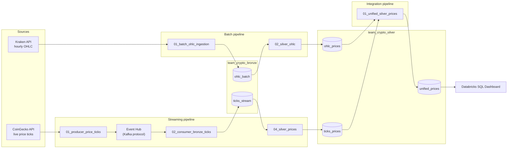

# crypto-demo

Team project for the Databricks/Azure Data Engineering course: a batch + streaming pipeline for crypto prices (BTC, ETH, SOL), merged into one silver table and shown on a dashboard.

## Architecture



Batch and streaming run independently and each writes its own silver table (`ohlc_prices`, `ticks_prices`). The `integration_pipeline` combines both into one table, `unified_prices`, which feeds the dashboard.

## Repo structure

| Folder / file | What it does |
|---|---|
| `batch_pipeline/01_batch_ohlc_ingestion.ipynb` | Loads hourly OHLC data from Kraken API (BTC, ETH, SOL) into `team_crypto_bronze.ohlc_batch`, idempotent MERGE on `symbol, timestamp_unix` |
| `batch_pipeline/02_silver_ohlc.ipynb` | Casts types, normalizes symbol, dedups, MERGE into `team_crypto_silver.ohlc_prices` |
| `streaming_pipeline/01_producer_price_ticks.ipynb` | Polls CoinGecko `simple/price` every N seconds, sends JSON to Event Hub over the Kafka protocol. `bad_every` widget injects bad events for the data-quality demo |
| `lakeflow_pipeline/transformations/ticks_bronze.py` | Lakeflow streaming table: Event Hub (Kafka) → `team_crypto_bronze.ticks_bronze`, raw JSON plus Event Hub metadata |
| `streaming_pipeline/02_consumer_bronze_ticks.ipynb` | Structured Streaming from Event Hub (Kafka format) into `team_crypto_bronze.ticks_stream`, stored as raw JSON (no fixed schema — needed for the schema evolution demo) |
| `streaming_pipeline/03_schema_evolution_twist.ipynb` | Demo helper: checks that a new field reaches silver without restarting the stream |
| `streaming_pipeline/04_silver_prices.ipynb` | Infers schema from the newest bronze row (`F.schema_of_json`), normalizes symbol (bitcoin → BTC etc.), MERGE into `team_crypto_silver.ticks_prices` |
| `integration_pipeline/01_unified_silver_prices.ipynb` | Combines `ohlc_prices` + `ticks_prices` into one table with a `record_type` column (`ohlc_batch` / `streaming_tick`), MERGE into `team_crypto_silver.unified_prices` |
| `infra_setup.ipynb` | Schemas, volume, secret scope (Unity Catalog setup) |
| `README.md` | This file |

## Run order

1. `infra_setup.ipynb` — once, by whoever owns infra
2. `batch_pipeline/01_batch_ohlc_ingestion.ipynb` → `batch_pipeline/02_silver_ohlc.ipynb`
3. `streaming_pipeline/01_producer_price_ticks.ipynb` (runs in the background) → `streaming_pipeline/02_consumer_bronze_ticks.ipynb` (streaming job) → `streaming_pipeline/04_silver_prices.ipynb` (batch run on top of the stream)
4. `integration_pipeline/01_unified_silver_prices.ipynb` — last step, once both silver tables have data
5. Databricks SQL dashboard on top of `team_crypto_silver.unified_prices`

## Schema evolution demo

1. Start the producer and consumer, let them run for a few minutes
2. In `01_producer_price_ticks.ipynb`, uncomment the line that adds a new field, `volume_24h`
3. Restart only the producer — the consumer (`02_consumer_bronze_ticks`) doesn't need touching, since it just stores raw JSON
4. Rerun `04_silver_prices.ipynb` — the new field shows up automatically via `F.schema_of_json()` on the latest row, no code change and no stream restart needed

## Lakeflow streaming pipeline

The streaming part is moving from notebooks 02/04 to a Lakeflow Declarative Pipeline, `team-crypto-ticks-streaming`. Every `.py` file in `lakeflow_pipeline/transformations/` is picked up by the pipeline.

| Table | Layer | Contents |
|---|---|---|
| `<bronze_schema>.ticks_bronze` | bronze | `value` (raw JSON string), `eventhub_partition`, `eventhub_offset`, `eventhub_timestamp`, `source`, `ingestion_timestamp`, `load_date` |
| `_ticks_validated` | intermediate (private) | All Bronze records with parsed fields, normalized `symbol`, numeric `price_usd`, converted `event_time`, individual quality-rule results, `failed_rules`, `is_valid`, and `quarantine_reason` |
| `<silver_schema>.ticks_silver` | silver | Valid records deduplicated by `symbol, event_time, source`: `symbol`, `event_time`, `price_usd`, `quote_currency`, `source`, `transport_source`, `ingestion_timestamp`, `load_date`, `eventhub_partition`, `eventhub_offset`, `eventhub_timestamp` |
| `<silver_schema>.ticks_quarantine` | quarantine | Invalid records: original `value`, `raw_symbol`, `symbol`, `price_usd`, `event_time`, `failed_rules`, `quarantine_reason`, `source`, `ingestion_timestamp`, `load_date`, `eventhub_partition`, `eventhub_offset`, `eventhub_timestamp` |

Pipeline settings (serverless, triggered, development mode):

```json
{
  "name": "team-crypto-ticks-streaming",
  "catalog": "dbr_dev_ua5816bd",
  "schema": "team_crypto_silver",
  "serverless": true,
  "continuous": false,
  "development": true,
  "root_path": "/Workspace/Users/<you>/crypto-demo/lakeflow_pipeline",
  "libraries": [{"glob": {"include": "/Workspace/Users/<you>/crypto-demo/lakeflow_pipeline/transformations/**"}}],
  "configuration": {
    "catalog": "dbr_dev_ua5816bd",
    "bronze_schema": "team_crypto_bronze",
    "silver_schema": "team_crypto_silver",
    "eventhub_namespace": "evhua5816bd",
    "eventhub_name": "crypto-ticks",
    "secret_scope": "team-crypto-scope"
  }
}
```

Bad-data demo:
1. Run `01_producer_price_ticks.ipynb` with `bad_every = 4`: after every 4th good event it sends one bad event, cycling through negative price, missing symbol, missing price and an exact duplicate
2. Run the pipeline: all events land in bronze as is; data-quality rules are applied in silver

### Verification performed

| Dataset | Bronze | Silver | Quarantine | Duplicates removed |
|---|---:|---:|---:|---:|
| Messages read from Event Hub | 22 | 18 | 3 | 1 |

For the prepared dataset, rerunning without new input left row counts unchanged.

The Event Hub run completed successfully. Quarantine contained a negative price, a missing symbol, and a missing price. Silver contained 18 records with no duplicate business keys.

These counts describe specific test runs; they are not fixed expectations for future data.

Manual checks are in [streaming quality checks](lakeflow_pipeline/checks/streaming_quality_checks.ipynb). Update catalog and schema names for your environment. 

## Idempotency
The notebook batch and integration paths use Delta `MERGE`:

- `ohlc_batch`: `symbol, timestamp_unix`
- `ohlc_prices`: `symbol, event_time`
- Legacy notebook `ticks_prices`: `symbol, event_time`
- `unified_prices`: `symbol, event_time, record_type`

The legacy Bronze consumer and Lakeflow streaming tables use streaming writes rather than manual `MERGE`. Checkpoints track progress so ordinary reruns process new input.

Lakeflow Silver additionally removes duplicate business keys using `symbol, event_time, source`.

Checkpointing and deduplication serve different purposes: checkpointing tracks processed source records, while deduplication removes repeated business events.

Changing the source type, such as replacing a Delta test source with Kafka, requires a compatible fresh streaming state. A full refresh resets state and rebuilds streaming tables from currently available source data; it should not be used as an ordinary rerun.