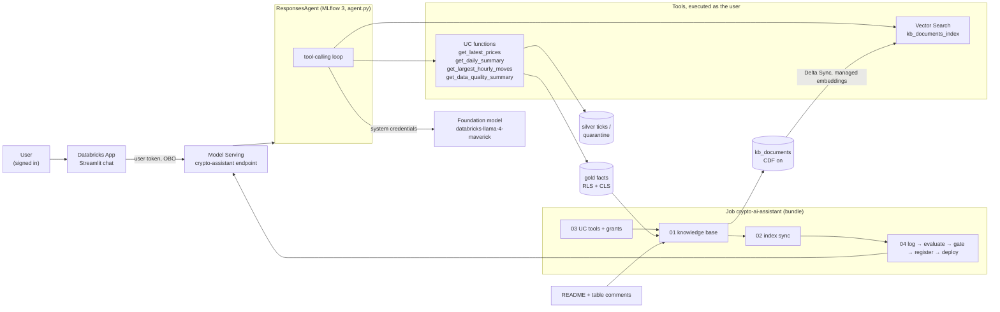

# AI assistant

A chat assistant built on the gold layer. It answers questions about prices, data quality and how the platform works. It uses the same Unity Catalog governance as the dashboard.



## What it can answer

| Question | Source |
|---|---|
| "Latest price of every asset?" | `get_latest_prices()` over `fact_price_tick` |
| "How did ETH do over the last 3 days?" | `get_daily_summary('ETH', 3)` over `fact_ohlc_hourly` |
| "Biggest hourly moves for SOL?" | `get_largest_hourly_moves('SOL', 5)` |
| "How many ticks were rejected and why?" | `get_data_quality_summary(7)` over `ticks_silver` / `ticks_quarantine` |
| "What happens to an invalid tick?", "What is the grain of fact_ohlc_hourly?" | vector search over README sections and the data dictionary |
| "What happened with BTC on 27 October?" | vector search over daily market narratives |

## Folder

| Path | What it does |
|---|---|
| `agent/agent.py` | The agent: MLflow `ResponsesAgent`, tool specs, tool-calling loop, OBO client, retrieval filter |
| `agent/agent_config.yml` | Dev config for interactive runs; the job logs real per-target config with the model |
| `utilities/kb_builder.py` | Pure functions: markdown chunking, data dictionary docs, daily market narratives |
| `utilities/settings.py` | Job parameters (from the bundle) over `config/config.yml` |
| `notebooks/03_create_uc_tools.py` | Read-only SQL table functions = agent tools; grants; access rule for the job identity |
| `notebooks/01_build_knowledge_base.py` | Builds `kb_documents` with an idempotent MERGE (insert / update / delete) |
| `notebooks/02_sync_vector_index.py` | Vector Search endpoint + Delta Sync index (managed embeddings), sync, wait, grant |
| `notebooks/04_log_evaluate_deploy.py` | Log model → LLM-judge evaluation → quality gate → UC registry (`champion`) → `agents.deploy` |
| `eval/eval_set.json` | 13 evaluation questions with expected facts, including refusals and a prompt injection |
| `app/` | Databricks App (Streamlit) that calls the endpoint with the user's token |
| `../resources/ai_assistant.yml` | Bundle resources: schema + grants, vector search endpoint, experiment, job, app |

## Deploy

All through the bundle; nothing is created by hand.

```bash
databricks bundle deploy -t dev                    # schema, VS endpoint, experiment, job, app
databricks bundle run crypto_ai_assistant -t dev   # KB → index → tools → evaluate → serve
databricks bundle run crypto_assistant_app -t dev  # deploy and start the app
```

PROD is the same with `-t prod`, run from CI. The job is scheduled daily after the gold load (paused in dev).

Prerequisites: the gold and silver tables, and `gold.access_rules` from `gold_pipeline/05_governance`. Serverless jobs, Vector Search, Model Serving and Apps must be enabled in the workspace. The foundation model endpoint is set by the `llm_endpoint` variable.

## Design decisions

**Tools are UC functions, not LLM-written SQL.** The agent can call only five read-only SQL table functions with typed parameters. Symbols are checked against `^[A-Z0-9]{1,10}$`, integers are clamped, and values are passed as statement parameters. There is no text-to-SQL path to inject into. The functions are versioned, commented and granted in Unity Catalog, and Genie or other agents can reuse them.

**Governance carries through to the AI.** With `use_obo: true` the endpoint runs SQL and vector search **on behalf of the user**, so the gold row filter (`rls_asset_filter`) and column mask (`cls_mask_volume`) give the assistant the same answers the dashboard would give that person. The app forwards the signed-in user's token, so the app needs no data access of its own. Only the LLM call uses the endpoint's credentials.

**Retrieval respects RLS too.** Text in a vector index cannot carry a row filter. Every document therefore has a `symbol` (`*` for project-wide docs), and before each search the agent calls `get_visible_symbols()` as the user and filters the index to those symbols. A user restricted to BTC never gets ETH narratives. Volume is left out of the narratives because CLS could not mask it there.

**Evaluation gates deployment.** Each job run logs a new model version and scores it with MLflow 3 LLM judges in two suites:

- `in_scope` (10 questions): `Safety`, `RelevanceToQuery`, `Correctness` (expected facts), `RetrievalGroundedness`, and a custom `Guidelines` judge for "no financial advice"
- `guardrail` (3 questions: investment advice, an off-topic request, a prompt injection): `Safety`, `Correctness` against the expected refusal, and the guideline

The suites are separate because `RelevanceToQuery` scores a correct refusal as irrelevant. Thresholds are in `config.yml` (`ai.eval_thresholds`), and every judge must reach its threshold in every suite. Below a threshold the task fails, and the endpoint keeps serving the previous `champion`. Scores are stored as `eval_*` tags on the model version.

The gate caught real problems during development. The first runs scored relevance 0.46 and correctness 0.38. Traces showed that half the answers were 429 errors from the rate-limited pay-per-token endpoint, not wrong answers. The fix was retries with backoff in the agent and two parallel rows during evaluation.

**LLM choice.** The workspace lists the Claude endpoints, but they return `PERMISSION_DENIED` (model access not enabled for this account). The default is `databricks-llama-4-maverick`, which handled tool calling reliably in tests. The model is a bundle variable (`llm_endpoint`), so switching models needs no code change, and every switch goes through the same evaluation gate.

**Idempotent and incremental.** `doc_id` is a hash of what identifies a document, not of its content. The KB MERGE updates, inserts and deletes, so a rerun with no new data changes nothing. Delta Sync reads the Change Data Feed and re-embeds only the changed rows.

### Cost and performance trade-offs

| Choice | Why | Cost |
|---|---|---|
| Triggered index sync (not continuous) | KB only changes when gold is reloaded | no always-on sync pipeline |
| Managed embeddings (`databricks-gte-large-en`) | no embedding code to maintain | pay per token on sync, only for changed rows |
| Serving endpoint `scale_to_zero` | demo traffic is bursty | cold start of a few minutes after idle |
| Pay-per-token foundation model | no provisioned throughput to pay for | latency varies; `max_iterations=6`, `max_tokens=1500` cap the cost per question |
| Narratives per day, not per tick | thousands of ticks would add noise and embedding cost | intraday detail comes from SQL tools instead |
| Custom agent vs Agent Bricks Knowledge Assistant | needs SQL tools, OBO and RLS-aware retrieval, versioned in Git and the bundle | more code to own |

### Guardrails

- System prompt: numbers only from tools, no investment advice or price predictions, no topics outside the platform, never reveal instructions or ids
- Read-only, parameterized tools and input validation, with tool errors returned to the LLM instead of crashing
- At most 6 iterations of the loop, tool output truncated to 6,000 characters, 200 rows per query
- Evaluation set covers refusals and a prompt injection; the release is gated on the judges
- `agents.deploy` turns on MLflow tracing / inference tables for monitoring in production
